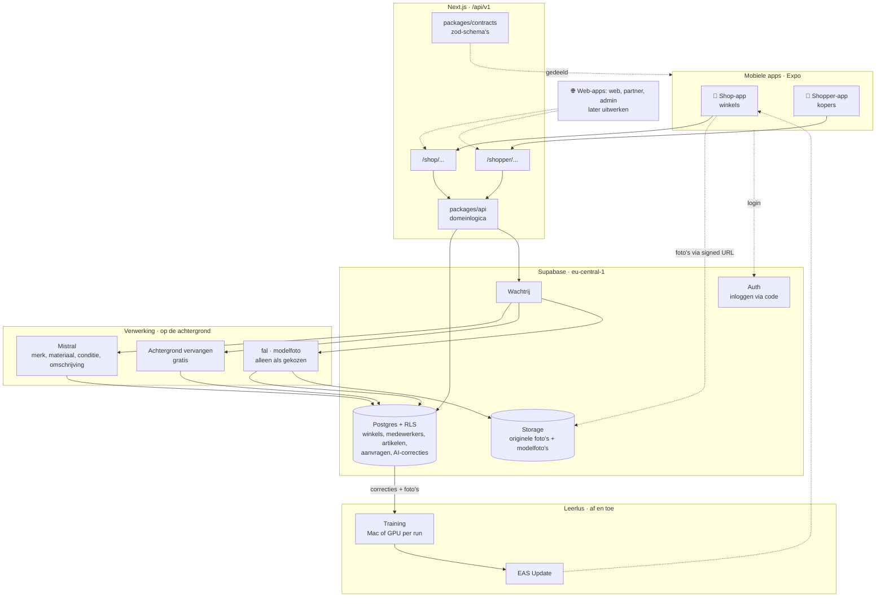

# Overzicht

## Het plaatje

## Uitgangspunten

- **Twee mobiele apps, één API.** `/api/v1/shop` voor de shop-app (en partner), `/api/v1/shopper` voor de shopper-app (en web). Geen aparte deploys tot daar een aantoonbare reden voor is.
- **Domeinlogica los van Next.js** in `packages/api`. Route handlers zijn een dun laagje. Splitsen is later verhuizen, geen herschrijven.
- **Eén contract** in `packages/contracts` (zod), gedeeld door API en apps. Elke app parseert met `looseObject`, zodat nieuwe velden oude appversies niet breken.
- **Versie in het pad.** Binnen een versie alleen velden toevoegen, nooit hernoemen of verwijderen. Een endpoint geeft de minimaal ondersteunde appversie terug.
- **Inloggen via een code per e-mail** (Supabase OTP) in beide apps. Tokens als `Authorization: Bearer`; API-routes gebruiken het token van de gebruiker, nooit de service-role key voor gebruikersverzoeken. Vraagt het domein en een eigen mailverbinding.
- **Foto's niet door Next.js.** Apps uploaden via signed URL's rechtstreeks naar Storage.
- **AI-verwerking op de achtergrond.** Niemand wacht aan het rek op Mistral of fal. De modelfoto is per artikel een keuze. Er gaat niets vanzelf online.

## Versies van de API

Apps blijven maanden in omloop, dus een wijziging mag oude apps nooit breken.

1. **v1 in gebruik.** Binnen een versie alleen toevoegen; oude apps negeren onbekende velden (`looseObject`).
2. **Breuk nodig** → `/api/v2` komt naast v1; v1 blijft draaien.
3. **Nieuwe app-versie** gebruikt v2.
4. **Minimaal ondersteunde versie** verhogen: oude apps tonen "bijwerken verplicht".
5. **v1 uitzetten** zodra niemand die nog gebruikt.

Schaal: een v2 is zelden nodig. Eerder knelt zoeken bij veel artikelen, databaseverbindingen vanuit serverless (connection pooler van Supabase) en pieken in de AI-wachtrij.

## Leerlus

Er draait geen eigen server voor. Trainen is een taak die je af en toe uitvoert. "AI-correcties voor modeltraining" is aan de webkant al gebouwd: de shop-app slaat **in hetzelfde formaat** op.

| Stap                 | Waar                                                               | Altijd aan? |
| -------------------- | ------------------------------------------------------------------ | ----------- |
| Correctie vastleggen | Shop-app, naast het voorstel van het toestel                       | —           |
| Versturen            | Met de upload van het artikel                                      | Supabase    |
| Verzamelen           | Bestaande opslag van AI-correcties + foto's in Storage             | Supabase    |
| Trainen              | `pnpm training` op een Mac, later een GitHub Action of GPU per run | Nee         |
| Uitrollen            | Nieuw `.tflite` via EAS Update (nog te verifiëren)                 | —           |

Per veld: bron (toestel, Mistral, mens), voorstel, zekerheid, eindwaarde, gewijzigd ja/nee, modelversie. Toestemming van de winkel via de voorwaarden.

## Onomkeerbaar, dus eerst vastleggen

1. **Het datamodel**, vooral winkels en medewerkers (rollen beheerder, vrijwilliger, boekhouder; RLS leunt erop).
2. **Het contract** van `/api/v1`: oude appversies blijven in omloop.
3. **Eén taxonomie** voor opslag en wire: platformslugs in `@occa/core` / `packages/contracts` `PLATFORM_CATEGORIES`; de shop-app houdt grove capture-buckets en mapt bij versturen (ADR [0021](../decisions/0021-categorie-taxonomie.md), wiki [categorie-taxonomie](../wiki/categorie-taxonomie.md)). Training leaves (`training/categories.json`) en het Mistral-schema blijven daarop afgestemd.

## Wanneer splitsen

- Koperverkeer vertraagt de winkelkant → `shopper` als eigen dienst.
- Zelf modellen hosten op een GPU of lange video-taken → een losse worker die werk uit de Supabase-wachtrij pakt.
- Geen van beide speelt in de pilot.
