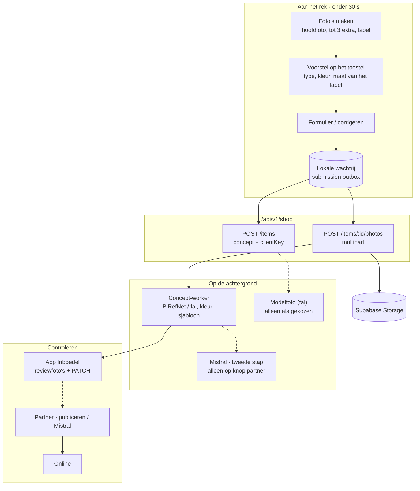

# Partner-app (mobiel)

Voor beheerders en vrijwilligers van een winkel. Doel: een artikel aan het rek invoeren in minder dan 30 seconden. Bewerken en omschrijven gebeuren daarna op de achtergrond; het artikel komt binnen als concept.

Productnaam: **partner-app** (Expo). Partner-web is de laptop-backoffice. API-pad blijft `/api/v1/shop`.

**Nu gebouwd:** scannen → outbox → concept + multipart-foto's → concept-worker → Inboedel (`photoStatus`, reviewfoto's, PATCH). **Pilot-publiceren:** nog op partner-web. **Later:** publiceren in de app, websocket. Volledige techniek: [techniek.md](../techniek.md) (spiegel van Drive / platform `docs/product/techniek.md`).

> Voorstel: deze route (formulier aan het rek, controleren later) staat nog niet in proces 2.3. Daar controleert de vrijwilliger in hetzelfde scherm.

## Aan het rek (op het toestel)

- Foto's: hoofdfoto, tot 3 extra, label. Label is **bedoeld** optioneel; de app eist labeltekst bij Opslaan nog.
- Bijsnijden, verkleinen (≤1540 / JPEG 0,82), OCR, TFLite-type, pixelkleur.
- Geen cloud-AI in dit formulier.

## Inloggen

- E-mail en wachtwoord tegen **Supabase Auth**, dezelfde accounts als partner.
- Tokens: `Authorization: Bearer` naar de shop-API.

## Inboedel

1. `GET …/stores` → filialen.
2. `GET …/items` → voorraad incl. `concept` + `photoStatus`.
3. Detail: reviewfoto's + PATCH; verversen bij focus / pull-to-refresh (geen poll).

## Versturen

1. Outbox op het toestel.
2. `POST …/items` met `clientKey`.
3. `POST …/items/{id}/photos` multipart; bij main → `photo_job`.

## Op de achtergrond

- Concept-worker zonder Mistral; Mistral alleen op partner-knop.
- Modelfoto alleen als gekozen (nog niet in de app).

## Controleren

- App: origineel / op achtergrond / uitsnede + velden.
- Partner: volledige controle, publiceren (publiceren vanuit app = later).

## In deze repo nog te doen

- Label optioneel; rek-formuliervelden; modelfoto-keuze.
- Persistente scan-store; OTP-login; AI-correcties; publiceren; websocket; aanvragen.
