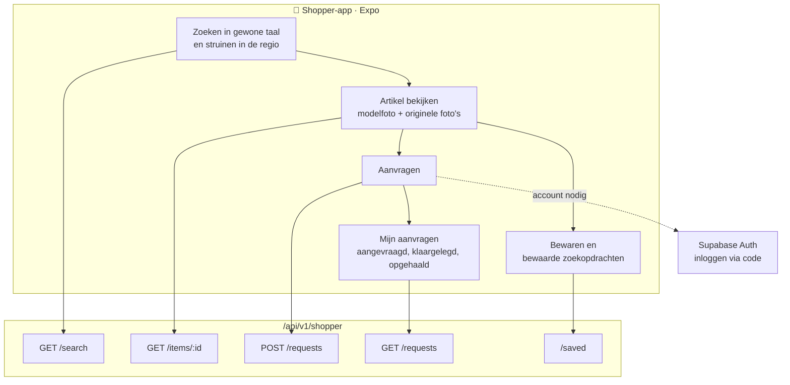

# Shopper-app

Voor kopers: zoeken, struinen, bewaren en aanvragen bij tweedehandswinkels in de buurt. Voorstel: bouwen **na de pilot**; tijdens de pilot bedient web de kopers.

## Uitgangspunten

- Deelt `/api/v1/shopper` met web: dezelfde zoek-, bewaar- en aanvraaglogica.
- **Zoeken en struinen zonder account**; aanvragen en bewaren met account (proces 1.2: aanvragen alleen met een account). Dan moet `/shopper/search` publiek zijn, met rate limiting.
- **Aanvragen, nooit reserveren.** Limieten en termijnen volgen proces 1.2 (voorstel: 10 open per koper, 3 per vestiging, ophalen binnen 3 werkdagen).
- Betalen gebeurt in de winkel, niet via Occa.
- Artikelpagina's tonen naast de modelfoto altijd de originele en detailfoto's, zodat de staat eerlijk zichtbaar is.
- Meldingen in de app; mail, sms of WhatsApp wachten op het domein en een aanbieder.
