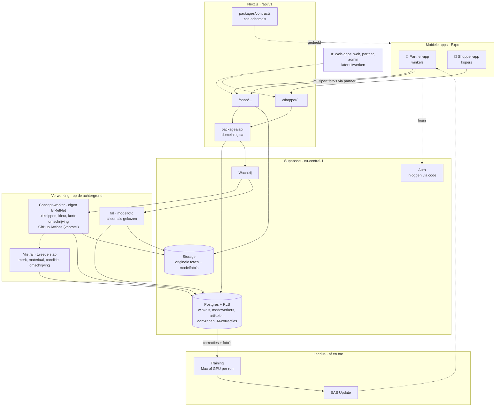
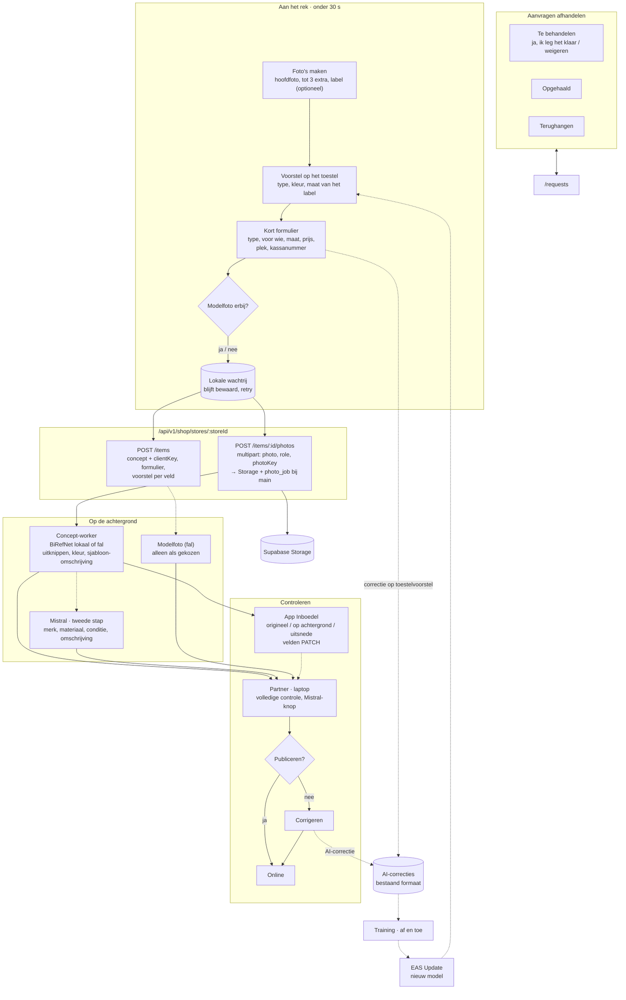
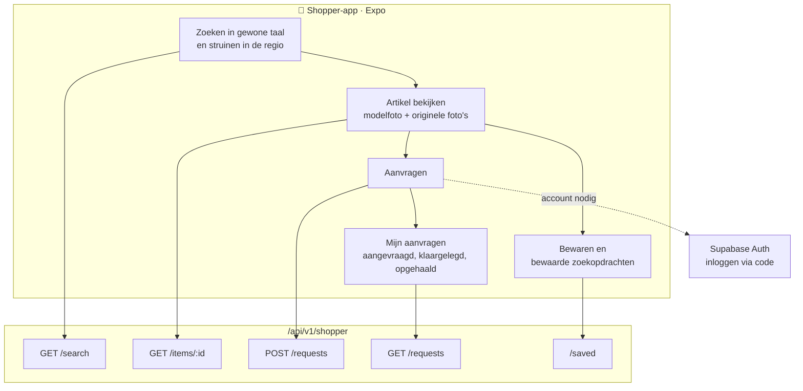
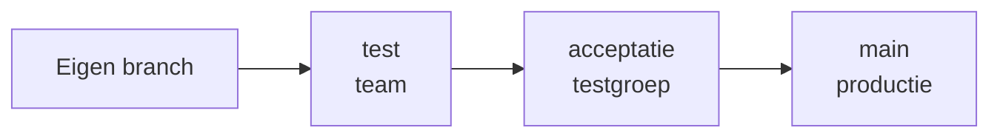
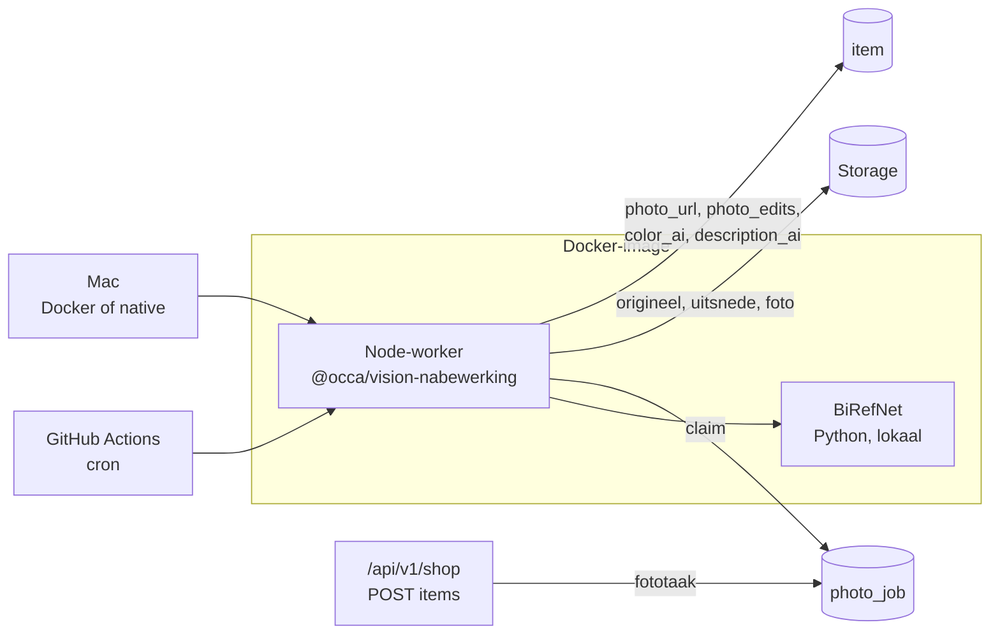
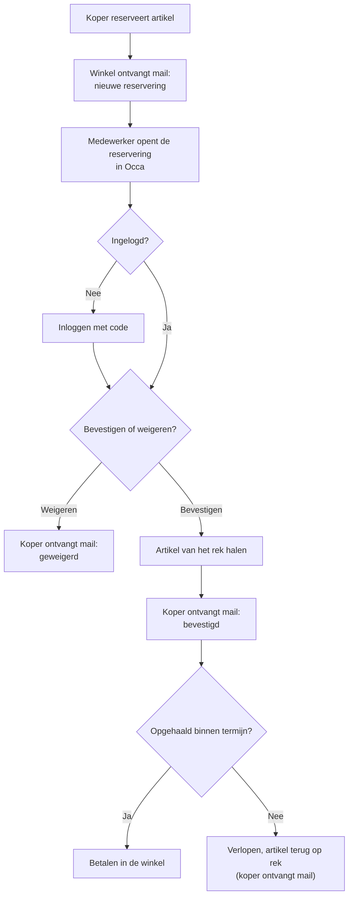
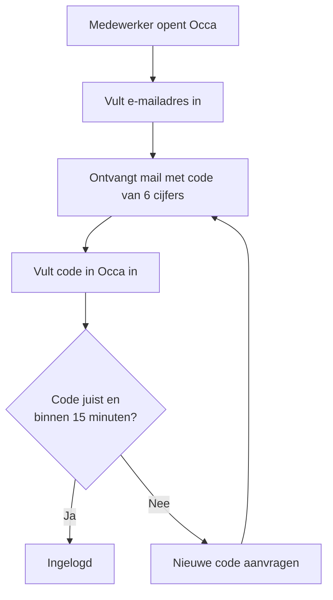

# Occa – Techniek

Christiaan Färber · bijgewerkt 22 november 2026 (avond: partner-upload, reviewfoto's, foto-grootte, categorie-taxonomie)

Dit document beschrijft hoe Occa technisch in elkaar zit en welke keuzes we maken. Het is de bron voor techniek; product en planning staan in de map Product. Eén bestand met een inhoudsopgave; besluiten staan los in `besluiten/`, onderzoek in `onderzoek/`.

**Kopieën.** Platform-repo: `docs/product/techniek.md`. Google Drive: zelfde bestand. Sinds 22 nov 2026 (avond) is **deze repo leidend** voor partner-app-status, multipart-upload, foto-grootte en categorie-taxonomie; Drive en platform-kopie daarop syncen. Oudere Drive-export (status “apps nog voorstel”, taxonomie alleen model/training) niet terugzetten over deze tekst.

**Termen.** _Aanvragen_, nooit "reserveren": het systeem zegt "aangevraagd" tot het artikel is klaargelegd. _Modelfoto_: de foto zonder zichtbare paspop (ghost mannequin), per artikel een keuze. _Concept_: een artikel dat nog niet online staat.

**Status.** De **partner-app** (Expo, winkels) heeft het kernpad gebouwd: inloggen (e-mail + wachtwoord, zelfde accounts als partner-web), scannen, outbox, concept + foto's via `/api/v1/shop`, Inboedel (lijst/detail/PATCH), reviewfoto's (origineel / op achtergrond / uitsnede) en client-side verkleinen (≤1540 px). De **shopper-app** is nog een voorstel (na de pilot). Publiceren vanuit de app en websocket voor `photoStatus` staan gepland maar zijn niet gebouwd.

**Naamgeving.** Productnaam voor de winkelkant is **partner** (web = partner, mobiel = partner-app). Het HTTP-pad blijft `/api/v1/shop` (technisch contract, geen productnaam).

## Inhoud

- [Platform en apps](#platform-en-apps)
  - [Het plaatje](#het-plaatje)
  - [Uitgangspunten](#uitgangspunten)
  - [Onomkeerbaar, dus eerst vastleggen](#onomkeerbaar-dus-eerst-vastleggen)
  - [Wanneer splitsen](#wanneer-splitsen)
- [Partner-app](#partner-app)
  - [Aan het rek (op het toestel)](#aan-het-rek-op-het-toestel)
  - [Versturen](#versturen)
  - [Op de achtergrond](#op-de-achtergrond)
  - [Controleren (op partner)](#controleren-op-partner)
  - [Aanvragen afhandelen](#aanvragen-afhandelen)
  - [Nog te doen in de app-repo](#nog-te-doen-in-de-app-repo)
- [Shopper-app](#shopper-app)
  - [Regels voor de shopper-app](#regels-voor-de-shopper-app)
- [API en versies](#api-en-versies)
- [Omgevingen](#omgevingen)
  - [Vier omgevingen](#vier-omgevingen)
  - [Wat er nog moet gebeuren](#wat-er-nog-moet-gebeuren)
- [AI en leerlus](#ai-en-leerlus)
  - [Concept zonder Mistral](#concept-zonder-mistral)
  - [De concept-worker](#de-concept-worker)
  - [Leerlus](#leerlus)
- [Data, mail, security en hosting](#data-mail-security-en-hosting)
  - [Waar het om gaat](#waar-het-om-gaat)
  - [In het kort](#in-het-kort)
  - [Data](#data)
  - [Mail](#mail)
  - [Security: inloggen met een code](#security-inloggen-met-een-code)
  - [Hosting](#hosting)
  - [Bewust niet voor de pilot](#bewust-niet-voor-de-pilot)
  - [Wel interessant om te meten](#wel-interessant-om-te-meten)
- [Web-apps](#web-apps)
- [Documentatie en bronnen](#documentatie-en-bronnen)
  - [Regels](#regels)
  - [Op de hoogte blijven](#op-de-hoogte-blijven)
- [Open vragen](#open-vragen)
- [Bronnen](#bronnen)

## Platform en apps

Occa heeft twee mobiele apps (partner en shopper) en drie web-apps (web, partner en admin). Dit hoofdstuk werkt de mobiele apps uit; de web-apps volgen later.

### Het plaatje

### Uitgangspunten

- **Twee mobiele apps, één API.** `/api/v1/shop` voor de partner-app en partner-web (API-pad blijft `/shop`), `/api/v1/shopper` voor de shopper-app (en web). Geen aparte deploys tot daar een aantoonbare reden voor is.
- **Domeinlogica los van Next.js** in `packages/api`. Route handlers zijn een dun laagje. Splitsen is later verhuizen, geen herschrijven.
- **Eén contract** in `packages/contracts` (zod), gedeeld door API en apps. Elke app parseert met `looseObject`, zodat nieuwe velden oude appversies niet breken.
- **Versie in het pad.** Binnen een versie alleen velden toevoegen, nooit hernoemen of verwijderen. Een endpoint geeft de minimaal ondersteunde appversie terug.
- **Inloggen.** Pilot/partner-app nu: e-mail + wachtwoord (Supabase, zelfde accounts als partner). Voorstel blijft OTP-code per e-mail (geen wachtwoord) zodra mail/domein staat. Tokens als `Authorization: Bearer`; API-routes gebruiken het token van de gebruiker, nooit de service-role key voor gebruikersverzoeken.
- **Foto's via partner (multipart).** De partner-app stuurt JPEG's naar `POST …/items/{id}/photos`; partner normaliseert (`resizeForAnalysis`, ≤1540 / JPEG 82) en zet ze in Storage. Geen signed-upload-URL meer vanuit de app. (De app verkleint al bij crop tot ≤1540 / JPEG 0,82.)
- **AI-verwerking op de achtergrond.** Niemand wacht aan het rek op Mistral of fal. De modelfoto is per artikel een keuze. Er gaat niets vanzelf online.
- **Eerst een concept zonder Mistral.** De concept-worker (`services/image-pipeline`) maakt de uitgeknipte foto, de kleur en een korte omschrijving; Mistral is een tweede stap met een kleiner pakket, alleen op knop op partner. Zie [Concept zonder Mistral](#concept-zonder-mistral).

### Onomkeerbaar, dus eerst vastleggen

1. **Het datamodel**, vooral winkels en medewerkers (rollen beheerder, vrijwilliger, boekhouder; RLS leunt erop).
2. **Het contract** van `/api/v1`: oude appversies blijven in omloop.
3. **Eén taxonomie voor opslag:** platformslugs in `@occa/core` / contracts; de partner-app houdt grove capture-buckets en mapt bij versturen. Nieuw type: eerst platform (of synoniem), Inboedel volgt via API; scan-bucket alleen bewust. Zie [ADR 0021](decisions/0021-categorie-taxonomie.md) en [wiki/categorie-taxonomie.md](wiki/categorie-taxonomie.md). Training leaves (`training/categories.json`) en Mistral blijven daarop afgestemd.

### Wanneer splitsen

- Koperverkeer vertraagt de winkelkant → `shopper` als eigen dienst.
- Zelf modellen hosten op een GPU of lange video-taken → een losse worker die werk uit de Supabase-wachtrij pakt.
- Het tweede punt speelt: we hosten BiRefNet zelf voor het uitknippen (`services/image-pipeline`). Lokaal op de Mac (Docker of native); GitHub Actions komt later, niet op een eigen server in de pilot. Het eerste punt (shopper splitsen) speelt in de pilot niet.

## Partner-app

Voor beheerders en vrijwilligers van een winkel. Doel: een artikel aan het rek invoeren in minder dan 30 seconden. Bewerken en omschrijven gebeuren daarna op de achtergrond; het artikel komt binnen als concept.

**Nu gebouwd:** scannen → outbox → concept + foto's → worker → Inboedel met `photoStatus` en reviewfoto's; conceptvelden PATCH'en in de app. **Nog op partner-web (pilot):** volledige controle, Mistral-knop, publiceren. **Besloten later:** publiceren ook vanuit de app; realtime status via websocket.

> Voorstel: deze route (formulier aan het rek, controleren later) staat nog niet in proces 2.3. Daar controleert de vrijwilliger in hetzelfde scherm.

### Aan het rek (op het toestel)

- Foto's: een hoofdfoto, tot 3 extra en het label (gelijk aan het web). Het label is **bedoeld optioneel** (vintage heeft vaak geen label); de app eist het labeltekstveld nu nog bij Opslaan — dat moet nog losser.
- Op het toestel: bijsnijden tot het kader, **verkleinen** (lange kant ≤1540, JPEG ~0,82), tekstherkenning van het label, type via `occa_category.tflite`, kleur uit pixels, maat uit de labeltekst. Een maat komt alleen van het label.
- Formulier met voorstellen; de vrijwilliger tikt alleen als iets niet klopt. (Doelvelden: type, voor wie, maat, prijs, plek, kassanummer — deels nog bijwerken in de UI.)
- Keuze: modelfoto erbij of niet — **nog niet in de app**.
- Geen AI-velden uit de cloud in dit formulier: daar zou men op gaan wachten.

### Versturen

1. Artikel gaat in een **lokale wachtrij die bewaard blijft** (`submission.outbox`). "Verzonden" betekent opgeslagen op het toestel.
2. `POST /api/v1/shop/stores/{storeId}/items` met formulier, voorstellen en `clientKey` (`scan-{id}`). Idempotent.
3. Per foto: `POST …/items/{itemId}/photos` (multipart: `photo`, `role`, `photoKey`). Partner normaliseert en slaat op; bij `role=main` komt er een `photo_job`.
4. De app toont `photoStatus` (`wachtend` / `bezig` / `klaar` / `mislukt`) op Inboedel. Verversen: scherm weer in beeld of naar beneden trekken. **Geen polling** (besluit 22 nov 2026); later websocket.

### Op de achtergrond

1. **Concept-worker** (`services/image-pipeline`), zonder Mistral: de hoofdfoto uitknippen (eigen BiRefNet of `CUTOUT_ENGINE=fal`), nabewerking, kleur uit de uitsnede, korte omschrijving uit sjabloon. Faalt de kwaliteitscheck, dan blijft de foto zoals hij was. Naar BiRefNet/fal gaat max. lange kant **1024**; het masker gaat terug op de master ≤1540.
2. **Mistral als tweede stap**, met formuliervelden en voorstellen als context. Alleen als een vrijwilliger op partner op de knop drukt. Hoogstens 2 uitlezingen per artikel.

- Modelfoto alleen als gekozen. Kosten tellen mee in AI-kosten per winkel (admin).
- Op partner blijft de knop "achtergrond" voorlopig via fal lopen: die moet direct klaar zijn.

### Controleren

- **In de app (gebouwd):** Inboedel-detail toont na de worker **origineel**, **op achtergrond** en **uitsnede** (signed URLs uit `photos.original` / `main`+`background` / `cutout`). Conceptvelden mag je PATCH'en.
- **Op partner (pilot):** volledige controle, Mistral-knop, publiceren. Groter scherm, typen, import/bulk.
- Een concept mag online zonder modelfoto; die kan later volgen _(voorstel)_.
- Elke wijziging op een voorstel is een AI-correctie (formaat nog niet vanuit de app).

**Later:** publiceren vanuit de app (besluit open vraag 9); websocket voor fotostatus (open vraag 10).

### Aanvragen afhandelen

Volgt proces 1.2 tot 1.4: Te behandelen (ja, ik leg het klaar of weigeren met reden), Opgehaald, Terughangen.

### Nog te doen in de app-repo

**Klaar (22 november 2026):** domein `submission` (outbox), multipart foto-upload, Inboedel + detail/PATCH, `photoStatus`, reviewfoto's, crop ≤1540, e-mail/wachtwoord-login (Supabase).

**Nog open:**

- Label optioneel maken (`canSubmitCaptureDraft` eist nu labeltekst).
- Formulier: voor wie, prijs, plek en kassanummer afstemmen op het rek-formulier; merk/omschrijving-beleid.
- Keuze voor de modelfoto.
- Scan-store persistent op het toestel (nu vooral sessie/geheugen + outbox).
- OTP-login (code per mail) i.p.v. wachtwoord, als mail/domein klaar is.
- Patroon meesturen (wordt nu herkend maar niet bewaard).
- Correcties in het formaat van de bestaande AI-correcties, met modelversie en zekerheid per veld.
- Publiceren vanuit de app (concept → online).
- Websocket voor `photoStatus`.
- Aanvragen afhandelen.

## Shopper-app

Voor kopers: zoeken, struinen, bewaren en aanvragen bij tweedehandswinkels in de buurt. Voorstel: bouwen **na de pilot**; tijdens de pilot bedient web de kopers.

### Regels voor de shopper-app

- Deelt `/api/v1/shopper` met web: dezelfde zoek-, bewaar- en aanvraaglogica.
- **Zoeken en struinen zonder account**; aanvragen en bewaren met account (proces 1.2: aanvragen alleen met een account). Dan moet `/shopper/search` publiek zijn, met rate limiting.
- **Aanvragen, nooit reserveren.** Limieten en termijnen volgen proces 1.2 (voorstel: 10 open per koper, 3 per vestiging, ophalen binnen 3 werkdagen).
- Betalen gebeurt in de winkel, niet via Occa.
- Artikelpagina's tonen naast de modelfoto altijd de originele en detailfoto's, zodat de staat eerlijk zichtbaar is.
- Meldingen in de app; mail, sms of WhatsApp wachten op het domein en een aanbieder.

## API en versies

Apps blijven maanden in omloop, dus een wijziging mag oude apps nooit breken.

1. **v1 in gebruik.** Binnen een versie alleen toevoegen; oude apps negeren onbekende velden (`looseObject`).
2. **Breuk nodig** → `/api/v2` komt naast v1; v1 blijft draaien.
3. **Nieuwe app-versie** gebruikt v2.
4. **Minimaal ondersteunde versie** verhogen: oude apps tonen "bijwerken verplicht".
5. **v1 uitzetten** zodra niemand die nog gebruikt.

Schaal: een v2 is zelden nodig. Eerder knelt zoeken bij veel artikelen, databaseverbindingen vanuit serverless (connection pooler van Supabase) en pieken in de AI-wachtrij.

## Omgevingen

_(Voorstel, 22 november 2026.)_ Vandaag kent het platform twee omgevingen (test en productie, `APP_ENV=test|production`) en lokaal praten de apps met het testproject. De partner-app kent al vier buildprofielen. We trekken dat gelijk naar vier omgevingen, met overal dezelfde namen. De stappen en variabelen per omgeving staan in het platform, in `docs/product/omgevingen.md`; hier staat alleen het plaatje.

### Vier omgevingen

| Omgeving   | `APP_ENV`    | Voor wie          | Platform (web, partner, admin)         | Supabase                        | Concept-worker                                     | Partner-app (EAS-profiel)                       | Status                          |
| ---------- | ------------ | ----------------- | -------------------------------------- | ------------------------------- | -------------------------------------------------- | ----------------------------------------------- | ------------------------------- |
| Lokaal     | `local`      | ontwikkelaar      | `pnpm dev` / `pnpm local:up` op de Mac | lokaal in Docker (Supabase CLI) | Docker op de Mac, of native met MPS                | `development`, naar het netwerkadres van de Mac | werkend (worker + seed)         |
| Test       | `test`       | team              | Vercel Preview, branch `test`          | het huidige project             | GitHub Actions, cron (later; tot dan vanaf de Mac) | `internal`                                      | te bouwen, worker later         |
| Acceptatie | `acceptance` | testgroep         | Vercel Preview, branch `acceptatie`    | eigen project                   | GitHub Actions, cron                               | `acceptance`                                    | voorbereid, nog niet aangemaakt |
| Productie  | `production` | winkels en kopers | Vercel Production, branch `main`       | nieuw Pro-project               | GitHub Actions of Scaleway                         | `production`                                    | voorbereid, nog niet aangemaakt |

- **Code gaat altijd dezelfde weg:** eigen branch, dan `test`, dan `acceptatie`, dan `main`.
- **Lokaal is echt lokaal.** De platform-apps en de worker praten met een Supabase in Docker op de Mac, niet meer met het testproject. Zo kun je niets kapotmaken in test. De migraties en `pnpm db:bootstrap` bouwen die lokale database op, net als straks productie.
- **Elke omgeving is herkenbaar.** De balk bovenin toont "Lokaal", "Testomgeving" of "Acceptatie"; in productie nooit.
- **Stripe:** een testsleutel in lokaal, test en acceptatie; een livesleutel alleen in productie.
- **De worker weigert productie**, tenzij dat bij het starten expliciet is aangezet. Hij logt bij elke start welke omgeving en welke Supabase hij gebruikt.
- **Geheimen per omgeving.** In Vercel per omgeving en branch. In GitHub Actions als repo-secrets met een voorvoegsel (`TEST_…`, later `ACCEPTANCE_…` en `PRODUCTION_…`), omdat losse GitHub Environments in een privé-repo een betaald plan vragen. Lokaal in `.env.local`-bestanden die nooit in git staan.

### Wat er nog moet gebeuren

- **Lokaal:** bouwen we eerst, samen met de concept-worker. Alles draait dan op de Mac, zonder GitHub Actions.
- **Test:** de API en de app gaan gewoon mee naar test. De worker op GitHub Actions volgt ongeveer een week later, samen met de keuze voor een GitHub-organisatie. Tot die tijd blijven fototaken op test wachten, of trek je ze leeg met de worker op de Mac.
- **Acceptatie:** een eigen Supabase-project (gratis organisatie, opgebouwd met `pnpm db:bootstrap`), de branch `acceptatie` met eigen Preview-variabelen in Vercel, `ACCEPTANCE_…`-secrets in GitHub, en een `acceptance`-build van de partner-app voor de testgroep. Stappenlijst volgt in `docs/product/omgevingen.md`.
- **Productie:** zoals al beschreven in `docs/product/omgevingen.md` (nieuw Pro-project, Vercel Pro, domein), plus de `PRODUCTION_…`-secrets voor de worker.
- **Besloten (22 november 2026):** acceptatie komt na productie, als er een vaste testgroep is. De testgroep zijn echte winkels met echte artikelen, dus voor acceptatie gelden dezelfde privacyregels als voor productie.

## AI en leerlus

Elke correctie van een vrijwilliger maakt de herkenning beter. De AI stelt voor, de mens bevestigt; er gaat niets vanzelf online en er zijn hoogstens 2 uitlezingen per artikel.

| Wat                                     | Waar                                                             | Kosten per artikel                                  |
| --------------------------------------- | ---------------------------------------------------------------- | --------------------------------------------------- |
| Type, kleur, maat van het label         | Op de telefoon (eigen klein model en tekstherkenning)            | Geen                                                |
| Uitknippen en achtergrond vervangen     | Concept-worker: eigen BiRefNet (lokaal) of fal (`CUTOUT_ENGINE`) | fal ~$0,0002; eigen worker binnen het gratis tegoed |
| Kleur uit de uitsnede                   | Concept-worker                                                   | Geen                                                |
| Korte omschrijving uit sjabloon         | Concept-worker                                                   | Geen                                                |
| Merk, materiaal, conditie, omschrijving | Mistral, op de achtergrond; _voorstel:_ tweede stap              | Klein, ~0,7 cent                                    |
| Modelfoto                               | fal, alleen als de winkel ervoor kiest                           | Het grootst                                         |

Bedragen zijn rekenvoorbeelden, geen metingen, behalve fal (uit de partner-code) en Mistral (unit economics v0.1). Een eigen model voor merk en conditie beoordelen we pas in de tweede helft van 2027, als het aantoonbaar beter of goedkoper is dan Mistral.

### Concept zonder Mistral

_(Besluit; zie `besluiten/2026-11-22-concept-zonder-mistral-en-eigen-worker.md`. Worker lokaal gebouwd.)_

Mistral is de grootste AI-kostenpost: bij 25 winkels met 500 tot 1.000 artikelen per maand €90 tot €175 per maand, tegenover €225 aan pilotabonnementen. Daarom maken we eerst een concept met wat we zelf kunnen weten, en gaat Mistral pas daarna, met een kleiner pakket.

**Wat er zonder Mistral al is:** type, subtype en patroon (telefoon), labeltekst (telefoon), de uitgeknipte foto, de kleur uit de pixels van het kledingstuk en een korte omschrijving uit de bekende velden ("Blauwe trui, maat M, Levi's"). Wat niet bekend is, blijft leeg; er wordt niets verzonnen.

**Wat Mistral daarna krijgt:**

- een bijgesneden uitsnede in plaats van de hele foto: minder beeldtokens bij dezelfde detailscherpte;
- de labeltekst in plaats van de labelfoto als de tekstherkenning zeker is; dan vervalt de tweede aanroep;
- alle voorstellen als hints, zodat Mistral controleert en aanvult in plaats van alles te raden.

Wat dit echt scheelt, meten we vóór de pilot door de bestaande meetopstelling (72 foto's) opnieuw te draaien met dit pakket. Mistral draait daarna alleen op de knop op partner.

### De concept-worker

`services/image-pipeline` in de platform-repo, zoals ADR-0002 al voorzag. **Lokaal draait dit** (Docker of native MPS); GitHub Actions volgt later.

- **Eén Docker-image** met een Node-worker en BiRefNet in Python. De Node-worker hergebruikt de nabewerking die partner al heeft (`@occa/vision`), zodat partner en worker precies hetzelfde resultaat geven. BiRefNet draait op een vaste modelversie, die bij het bouwen van de image wordt binnengehaald.
- **Wachtrij in Supabase:** tabel `photo_job` met status `wachtend`, `bezig`, `klaar` of `mislukt`. Een taak die vastloopt, wordt na een tijd opnieuw opgepakt; na drie pogingen is hij `mislukt`. Twee workers pakken nooit dezelfde taak.
- **Twee standen:** één keer de wachtrij afwerken en stoppen (GitHub Actions), of blijven draaien en elke 30 seconden kijken (de Mac tijdens testweken).
- **Eerst lokaal:** de worker draait eerst alleen op de Mac. GitHub Actions komt ongeveer een week later.
- **Overal dezelfde image:** op GitHub Actions (amd64), op de Mac (arm64, zelf gebouwd) en later op Scaleway of een andere containerdienst. Op een Mac heeft Docker geen toegang tot de GPU; snel draaien kan daar ook zonder Docker, met MPS.
- **fal als terugval:** met één instelling (`CUTOUT_ENGINE=fal`) knipt de worker via fal uit in plaats van zelf.
- **Kosten:** op GitHub Actions ~2.000 gratis minuten per maand; dat is ruwweg 12.000 foto's bij ~10 seconden per foto. Alleen tijdens openingstijden draaien, want elke run kost minstens een minuut. Een budget met "stop bij limiet" in GitHub voorkomt verrassingen. Overstappen naar Scaleway of Cloud Run als de minuten regelmatig op zijn, als concepten sneller klaar moeten zijn dan de cron, of als foto's alleen in de EU verwerkt mogen worden. GitHub-runners staan in de VS; omdat kledingfoto's geen persoonsgegevens zijn, hoeft GitHub niet in de privacyverklaring (besloten 22 november 2026).
- **Beheer:** een teamlid (naam nog in te vullen) beheert de minuten, het budget en de secrets.

### Leerlus

Er draait geen eigen server voor. Trainen is een taak die je af en toe uitvoert. "AI-correcties voor modeltraining" is aan de webkant al gebouwd: de partner-app slaat **in hetzelfde formaat** op.

| Stap                 | Waar                                                               | Altijd aan? |
| -------------------- | ------------------------------------------------------------------ | ----------- |
| Correctie vastleggen | Partner-app, naast het voorstel van het toestel                    | —           |
| Versturen            | Met de upload van het artikel                                      | Supabase    |
| Verzamelen           | Bestaande opslag van AI-correcties + foto's in Storage             | Supabase    |
| Trainen              | `pnpm training` op een Mac, later een GitHub Action of GPU per run | Nee         |
| Uitrollen            | Nieuw `.tflite` via EAS Update (nog te verifiëren)                 | —           |

Per veld: bron (toestel, worker, Mistral, mens), voorstel, zekerheid, eindwaarde, gewijzigd ja/nee, modelversie. Toestemming van de winkel via de voorwaarden.

**Later ook voor het uitknippen** _(voorstel)_: uitsneden die op partner worden afgekeurd of handmatig verbeterd, zijn trainingsdata om BiRefNet bij te trainen op onze eigen kledingfoto's. Het nieuwe model gaat dan met een nieuwe image-versie naar de worker, niet naar de telefoon.

## Data, mail, security en hosting

Voorstel voor de pilot (25 winkels, jan–feb 2027), 13 november 2026.

> **Status:** dit is mijn eigen uitwerking als denkrichting; het is bedoeld om samen te bespreken.

### Waar het om gaat

Occa kan nu geen mail versturen naar winkels of kopers. De standaardverzender die we gebruiken, bezorgt alleen bij adressen van ons eigen team. Uitnodigen, inloggen en meldingen werken daardoor niet, en dat blokkeert de pilot. Daarnaast moeten we vóór de pilot weten waar onze data staat en waar de site draait.

Dit document legt uit wat we gaan doen, waarom, en welke keuzes en gegevens we van jullie nodig hebben. De technische uitvoering regel ik.

### In het kort

- **Data:** staat al in de EU (Frankfurt). Hier hoeft niets te gebeuren.
- **Mail:** een eigen domein op de werknaam en een Europese maildienst (voorkeur: Scaleway), plus de adressen hello@, noreply@ en privacy@.
- **Security:** inloggen met een code van zes cijfers uit de mail, zonder wachtwoord en zonder klikbare link.
- **Hosting:** op Vercel blijven en vóór de pilot overstappen naar het betaalde pakket.

#### Wat het kost (rekenvoorbeelden, geen offertes)

| Post                  | Nu (bouwen)          | Pilot, 25 winkels   | 50 winkels          |
| --------------------- | -------------------- | ------------------- | ------------------- |
| Domein                | ± €10 per jaar       | ± €10 per jaar      | ± €10 per jaar      |
| Maildienst (Scaleway) | €0 tot enkele centen | ± €3 per maand      | ± €6 per maand      |
| Hosting (Vercel)      | €0                   | ± $20 per maand     | ± $20 per maand     |
| Mailbox (optioneel)   | €0                   | paar euro per maand | paar euro per maand |

Het maandbedrag voor Supabase (database en inloggen) staat hier nog niet in; dat zoek ik nog uit.

**Doorlooptijd:** zodra het domein en de maildienst er zijn, is het een halve dag werk (schatting).

### Data

**Gecontroleerd:** ons Supabase-project, met de database en het inloggen, draait in Frankfurt (regio eu-central-1). Dat is de juiste plek; hier hoeft niets te gebeuren.

#### Waarom dat belangrijk is

- **Privacy (AVG).** In Supabase staan straks e-mailadressen, namen, reserveringen en foto's van winkels en kopers. Omdat de database in de EU staat, blijft die data in de EU. Dat scheelt in wat we moeten verantwoorden en uitleggen in de privacyverklaring.
- **Vertrouwen bij partners.** BKN, kringloopwinkels en financiers gaan vragen waar hun gegevens staan. "In de EU" is een antwoord van één zin.
- **Snelheid.** Onze gebruikers zitten in Nederland, dus een database dichtbij is merkbaar sneller.
- **Moeilijk terug te draaien.** De regio ligt vast bij het aanmaken. Later verhuizen betekent alles overzetten, met kans op storingen bij actieve winkels. Dat dit goed staat, is dus een risico minder.

#### Wat het niet oplost

Supabase is een Amerikaans bedrijf. Ook met data in Frankfurt kan hun support vanuit de VS meekijken en valt de data onder Amerikaans recht. Supabase regelt dat met standaardafspraken uit de AVG in hun verwerkersovereenkomst. Voor de pilot vind ik dat een aanvaardbaar risico, mits we het eerlijk in de privacyverklaring noemen. Overstappen naar een volledig Europese dienst kost veel tijd en lost geen probleem op dat een pilotwinkel vandaag heeft. Dit is geen juridisch advies; laat het meenemen bij het toetsen van de privacyverklaring.

### Mail

Occa verstuurt mail op twee momenten: bij het inloggen (de code, zie Security) en bij elke stap van een reservering. Zo loopt een reservering:

#### Eigen domein

Mail die van een eigen domein komt, wordt vertrouwd door Gmail en Outlook en belandt niet in de spam. We registreren de werknaam nu al, ook al is de naam nog niet definitief: een domein kost een tientje per jaar en later wisselen is goed te doen.

#### Maildienst

We kiezen op vier punten: data in de EU, een verwerkersovereenkomst met een lijst van wie er nog meer bij kan, geen tracking van opens en kliks, en geschikt voor zowel inlogmails als reserveringsmails. Daarnaast wil ik een dienst die we vanaf nu tot ruim voorbij 50 winkels kunnen houden, zodat we niet steeds hoeven over te stappen.

| Kandidaat    | Gratis                | Daarna                                | Let op                                      |
| ------------ | --------------------- | ------------------------------------- | ------------------------------------------- |
| Scaleway TEM | 300 mails per maand   | €0,25 per 1.000 mails                 | Alleen transactionele mail, geen marketing  |
| AhaSend      | 1.000 mails per maand | $5 tot 10.000, daarna $0,50 per 1.000 | Jonger bedrijf                              |
| Brevo        | 300 mails per dag     | vanaf $15 voor 20.000                 | Daglimiet; support via Amerikaanse partijen |

**Voorkeur: Scaleway.** De hele dienst draait volgens Scaleway zelf binnen de EU, je betaalt per verstuurde mail zonder daglimiet, en het blijft tot ver voorbij 50 winkels een paar euro per maand. Het verschil met een gratis dienst is in de bouwfase hooguit een paar cent.

**Waarom geen gratis dienst met een daglimiet:** is de limiet op, dan komt er die dag geen inlogcode meer aan en kan niemand inloggen.

**Nog na te gaan:** of meldingen van bewaarde zoekopdrachten onder transactionele mail vallen. Valt Scaleway daarop af, dan is AhaSend de terugvaloptie.

#### Mailadressen

| Adres           | Waarvoor                                                                                                  |
| --------------- | --------------------------------------------------------------------------------------------------------- |
| hello@occa.nl   | Vragen van winkels en kopers                                                                              |
| noreply@occa.nl | Afzender van de mails die Occa automatisch verstuurt: inlogcodes, reserveringen, meldingen                |
| privacy@occa.nl | Privacyverzoeken, zoals inzage of een account laten verwijderen. Dit adres staat in de privacyverklaring. |

Een bereikbaar e-mailadres is wettelijk verplicht, zowel voor een online dienst (Burgerlijk Wetboek) als in de privacyverklaring (AVG). Privacyverzoeken moeten we binnen een maand beantwoorden. De namen van de adressen zijn vrij te kiezen.

**Antwoorden op automatische mails.** Mensen drukken toch op "beantwoorden", ook bij noreply@. Daarom stellen we bij die mails in dat een antwoord naar hello@ gaat. Zo raakt er geen vraag kwijt.

occa.nl is de werknaam. Komt er een andere naam, dan verhuizen de adressen mee.

#### Inbox: doorsturen of mailbox

De maildienst kan alleen versturen. Om hello@ en privacy@ te ontvangen, is een aparte voorziening nodig.

| Optie                           | Kosten              | Geschikt als                               |
| ------------------------------- | ------------------- | ------------------------------------------ |
| Doorsturen naar een eigen adres | Gratis              | Antwoorden mag vanaf een persoonlijk adres |
| Eigen mailbox                   | Paar euro per maand | We antwoorden vanaf hello@ zelf            |

De keuze hangt af van wie tijdens de pilot de vragen van winkels beantwoordt. Een mailbox oogt professioneler naar winkels; doorsturen is genoeg als het om een handvol vragen per week gaat. privacy@ kan in beide gevallen naar dezelfde plek gaan.

### Security: inloggen met een code

**Voorstel:** iedereen logt in met een code van zes cijfers die per mail komt. Geen wachtwoord en geen klikbare inloglink. Uitgenodigd worden, inloggen en weer toegang krijgen werken allemaal hetzelfde: vul de code uit je mail in. Dat past bij "nul training".

**Met medewerker bedoelen we** iedereen aan de kant van de winkel die artikelen invoert of reserveringen afhandelt: de eigenaar, personeel of een vrijwilliger. Niet de koper. Of kopers ook een account krijgen, staat nog open; als dat zo is, loggen zij op dezelfde manier in.

#### Waarom geen wachtwoord

- Geen "wachtwoord vergeten" en geen herstelflow.
- Geen wachtwoorden op een briefje bij de kassa of gedeeld tussen medewerkers.
- Niets wat kan uitlekken: we bewaren geen wachtwoorden.

#### Waarom een code en geen inloglink

- **Een link gaat kapot voordat de medewerker erop klikt.** Zakelijke mailfilters, zoals die van Outlook, openen elke link vooraf om te controleren of hij veilig is. Een inloglink werkt maar één keer, dus de medewerker krijgt daarna "link verlopen". Supabase, de dienst die ons inloggen regelt, noemt dit zelf als bekende oorzaak en raadt een code aan.
- **Mail en app staan vaak op verschillende apparaten.** Een medewerker leest de mail op de pc achter de toonbank, maar werkt in Occa op de winkeltelefoon. Een link opent dan op het verkeerde apparaat. Een code typ je overal in.
- **Een simpele regel tegen nepmail.** "Occa stuurt nooit een inloglink" kunnen we aan winkels uitleggen. Krijgen ze toch een link, dan weten ze dat die niet van ons is.

#### Nadelen en hoe we die opvangen

- **Overtypen kost moeite.** Daarom een groot invoerveld, een mail met alleen de code, en telefoons die de code zelf voorstellen.
- **Elke inlog hangt af van de mail.** Daarom testen we de bezorging bij de grote mailprogramma's vóór de pilot, kiezen we een maildienst zonder daglimiet, en blijft een medewerker op de winkeltelefoon lang ingelogd.

Een nieuwe medewerker toevoegen: de eigenaar vult een e-mailadres in, de medewerker opent Occa en logt in met de code uit de mail.

### Hosting

**Voorstel:** op Vercel blijven, waar het nu al staat, en vóór de pilot overstappen van het gratis naar het betaalde pakket.

- **Het gratis pakket mag niet commercieel gebruikt worden.** Occa is in 2027 gratis voor winkels, maar blijft een bedrijf met een verdienmodel, en vanaf Q2 komen er abonnementen bij.
- **Het gratis pakket heeft harde limieten.** Gaat de site daaroverheen, dan kan een onderdeel stilvallen tot de limiet reset. Midden in de pilot willen we dat niet.
- **Kosten:** ± $20 per maand voor één persoon die deployt. Meekijken kan gratis.
- **Waarom niet overstappen:** het werkt al, ik ken het, en overstappen kost tijd zonder dat een winkel er iets van merkt.

Vercel is een Amerikaans bedrijf. Het rekenwerk zetten we in Frankfurt, dicht bij de database, en we noemen Vercel als verwerker in de privacyverklaring.

**De concept-worker draait niet op Vercel** _(voorstel)_, maar als Docker-image op GitHub Actions; zie [De concept-worker](#de-concept-worker). Welke omgeving waar draait: [Omgevingen](#omgevingen).

### Bewust niet voor de pilot

- Nieuwsbrieven en marketingmail.
- Bijhouden wie een mail opent of op een link klikt.
- Een systeem om mailteksten zonder ontwikkelaar aan te passen.
- Meldingen bundelen. Een koper met bewaarde zoekopdrachten krijgt nu een mail per nieuw passend artikel. Later kan dat één samenvatting per dag worden ("vandaag 4 nieuwe artikelen voor je zoekopdrachten"). Dat scheelt mails en past bij rust aan de koperkant. We bekijken het opnieuw rond 50 winkels.

### Wel interessant om te meten

Niet via de mail, maar uit onze eigen gegevens in Occa. Daarvoor is geen tracking nodig.

- Hoeveel reserveringen er binnenkomen, per winkel en in totaal.
- Hoeveel daarvan medewerkers verwerken (bevestigen of weigeren), en hoeveel verlopen zonder reactie.
- Hoe snel een winkel reageert op een reservering.
- Hoeveel bevestigde reserveringen echt worden opgehaald.

Dit zegt na de pilot iets over hoe goed de reserveringsflow werkt bij winkels.

## Web-apps

Later uitwerken. Occa heeft drie web-apps naast de twee mobiele apps:

| Web-app | Voor wie         | API               |
| ------- | ---------------- | ----------------- |
| web     | kopers (webshop) | `/api/v1/shopper` |
| partner | winkels          | `/api/v1/shop`    |
| admin   | Occa beheer      | nog te bepalen    |

De processen staan in "Occa processen als swimlanes" (v0.6).

## Documentatie en bronnen

Alle documenten staan in de Google Drive-map Occa. Drive is de bron; geüploade kopieën (zoals pdf's in een Claude-project) verouderen ongemerkt.

| Map                | Eigenaar   | Inhoud                                  |
| ------------------ | ---------- | --------------------------------------- |
| Product            | Selim      | Roadmap, processen, pilot, businessplan |
| Techniek           | Christiaan | Dit bestand, `besluiten/`, `onderzoek/` |
| Design             | Christiaan | Design system en ontwerpen              |
| Compliance & Legal | Elio       | Voorwaarden, privacyverklaring          |

Code-specifieke documentatie (conventies en ADR's van een app, `architecture.md`) staat in de repo van die app, met een link naar Drive.

### Regels

- **Formaat:** markdown, diagrammen als mermaid-blokken. Geen losse Google Docs voor techniek: daarin zijn mermaid-diagrammen niet te tonen of te bewerken.
- **Eén bestand per eigenaar.** Techniek is `techniek.md`, met de inhoudsopgave bovenaan. Bij elke nieuwe of hernoemde kop wordt die bijgewerkt. Splitsen pas als het te lang wordt om in één keer te lezen.
- **Besluiten** krijgen elk een los bestand in `besluiten/` (`JJJJ-MM-DD-onderwerp.md`): besluit, reden, alternatieven. Nooit achteraf wijzigen; een nieuw besluit verwijst naar het oude.
- **Onderzoek en tests** in `onderzoek/`. Wat eruit volgt, gaat naar `techniek.md`.
- **Voorstellen zijn tijdelijk.** Na het besluit: verwerken in `techniek.md` of de productdocumenten, een besluit vastleggen, het voorstel archiveren.
- **Elk feit staat op één plek**; elders verwijzen.
- **Termen:** aanvragen (nooit reserveren), modelfoto, concept; producten partner-app (mobiel), shopper-app, web, partner (web), admin.

### Op de hoogte blijven

- Claude leest bij de start van een gesprek wat er in Product en Techniek is veranderd.
- Vraag aan Selim: zet naast elke pdf ook de bron (markdown) in Product, zodat wijzigingen per alinea te volgen zijn.

## Open vragen

- Domein: staat er al iets geregistreerd, en op wiens naam? Het liefst op een gedeeld Occa-account, niet op een persoonlijk. Akkoord om nu al op de werknaam te kopen?

- Budget: akkoord met ± $20 per maand voor hosting en een paar euro per maand voor mail, vanaf de pilot?

- Vragen: wie beantwoordt hello@ en privacy@ tijdens de pilot? Dat bepaalt doorsturen of mailbox.

- Privacyverklaring: wie schrijft die en wanneer? Supabase, Scaleway en Vercel moeten erin als verwerkers.

- Bestaande mail: is er al een Occa-mailbox of Google Workspace die we kunnen gebruiken?

- GitHub Actions: welk teamlid beheert de minuten, het budget en de secrets van de concept-worker? (Besloten is dat een ander teamlid het beheert; de naam nog invullen.) En komt er een gratis GitHub-organisatie (`occa-nl` of `occa-app` zijn vrij)? De platform-repo staat nu op het persoonlijke account van Selim. Pakken we op als de worker naar GitHub Actions gaat, ongeveer een week na de lokale bouw.

**Beantwoord (22 november 2026)**

- Wanneer draait Mistral na het concept? Pas als een vrijwilliger op partner op de knop drukt. Er gaat dus niets vanzelf naar Mistral.
- De meetopstelling (72 foto's) herhalen met uitgeknipte foto's en labeltekst? Ja, vóór de pilot.
- Acceptatie: na productie, als er een vaste testgroep is. Tot die tijd zijn lokaal en test genoeg.
- Testgroep: echte winkels met echte artikelen. Voor acceptatie gelden dus dezelfde privacyregels als voor productie.
- GitHub-runners in de VS: kledingfoto's zijn geen persoonsgegevens, dus GitHub hoeft niet als verwerker in de privacyverklaring. Aandachtspunt: dat geldt zolang er geen mensen op de foto's staan; de app-instructie blijft "kledingstuk alleen, zonder mensen".
- Hoe ziet de app dat de foto klaar is? Bij verversen: Inboedel of detail weer in beeld, of naar beneden trekken. Geen polling (bevestigd 22 nov 2026). Later websocket. Detail toont dan origineel / op achtergrond / uitsnede.
- Hoe uploadt de app foto's? Multipart naar `POST …/photos` (niet meer signed URL). Bevestigd 22 nov 2026.
- Welke foto-resolutie? Lange kant ≤1540 / JPEG 0,82 in de app en opnieuw bij partner; cut-out-send ≤1024. Bevestigd 22 nov 2026.

## Bronnen

- [Supabase – Change project region](https://supabase.com/docs/guides/troubleshooting/change-project-region-eWJo5Z)
- [Supabase – GDPR compliance](https://supabase.com/docs/guides/security/gdpr-compliance)
- [Supabase – Data residency and transfers FAQ](https://supabase.com/legal/privacy-resources/data-residency-and-transfers-faq)
- [Supabase – OTP verification failures (otp_expired)](https://supabase.com/docs/guides/troubleshooting/otp-verification-failures-token-has-expired-or-otp_expired-errors-5ee4d0)
- [Scaleway – Transactional Email FAQ](https://www.scaleway.com/en/docs/transactional-email/faq/)
- [Scaleway – Prijzen Transactional Email](https://www.scaleway.com/fr/tarifs/managed-services/)
- [AhaSend – Pricing](https://ahasend.com/pricing)
- [Vercel – Fair use guidelines](https://vercel.com/docs/platform/fair-use-policy)
