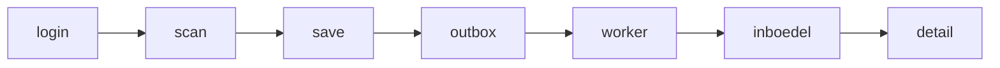

# Applicatieflow

> Gecontroleerd op: lokaal (2026-11-22)
> Bronnen: `src/app/`, `src/domeinen/capture/`, `auth/`, `inventory/`, `submission/`, `docs/occa-brief.md`
> Zie ook: [inloggen.md](inloggen.md), [scannen.md](scannen.md), [offline-upload.md](offline-upload.md), [inboedel.md](inboedel.md), [foto-grootte.md](foto-grootte.md), [home.md](home.md)

## Waarvoor

End-to-end pad van de medewerker vandaag: inloggen → foto → herkenning → corrigeren → opslaan →
outbox → partner/worker → Inboedel (status + reviewfoto's).

## Hoe het werkt

1. Splash tot fonts + sessie bekend; uitgelogd → login (e-mail/wachtwoord); ingelogd → app.
2. App opent op Home; scannen start via de start-actie.
3. Foto via camera (kader-crop) of gallery (pinch-align → crop); daarna verkleinen ≤1540 px.
4. On-device classify + optioneel label-OCR + pixelkleur → bewerkbaar formulier.
5. **Opslaan** schrijft naar `scanStore` én de outbox; navigatie naar home; upload op de achtergrond.
6. Outbox: `POST …/items` (clientKey) + multipart foto's; worker knipt/plakt op het platform.
7. Home: sessie-scans; tab **Inboedel**: API-voorraad, `photoStatus`, detail met reviewfoto's + PATCH.
8. Settings → Uitloggen → login (gebruikersdata gewist).

Publiceren (concept → online) en websocket: nog niet; zie open vraag 9–10.

## Beweringen

| ID      | Bewering                                                                     | Code                                | Test                    |
| ------- | ---------------------------------------------------------------------------- | ----------------------------------- | ----------------------- |
| FLOW-01 | Classificatie start pas na crop (camera) of na align-bevestiging (gallery).  | `capture-screen.tsx`                | —                       |
| FLOW-02 | Resultaatvelden worden pas in de store gezet bij Opslaan, niet bij classify. | `capture-screen.tsx` `save`         | `scan-store.test.ts`    |
| FLOW-03 | Na Opslaan gaat de navigatie naar `/home` en staat er een outbox-entry.      | `capture-screen.tsx`, `submission/` | `container.test.ts`     |
| FLOW-04 | Home toont sessie-scans gegroepeerd op herkende categorie.                   | `home-screen.tsx`, `group-scans.ts` | `group-scans.test.ts`   |
| FLOW-05 | Zonder sessie komt de medewerker niet in scan/app; login is de poort.        | `_layout.tsx`                       | —                       |
| FLOW-06 | Inboedel toont API-voorraad van het gekozen filiaal.                         | `inventory-screen.tsx`              | `container.test.ts`     |
| FLOW-07 | Vanuit de lijst opent detail; opslaan patcht via de shop-API.                | `inventory-item-screen.tsx`         | `container.test.ts`     |
| FLOW-08 | Detail toont reviewfoto's als de worker klaar is; status via focus/refresh.  | `review-photos.ts`, item-screen     | `review-photos.test.ts` |

## Randgevallen en bewuste keuzes

- Brief-flow "Volgende → status-icoon → cloud-controle-sheet" is **niet** volledig gebouwd; zie
  [ontwikkelstatus.md](ontwikkelstatus.md).
- Foto-grootte: [foto-grootte.md](foto-grootte.md).

## Open vragen

- Brief: groeperen foto's per item altijd via expliciete "Volgende"?
- Publiceren / websocket: [open-vragen.md](../functioneel/open-vragen.md) 9–10.
