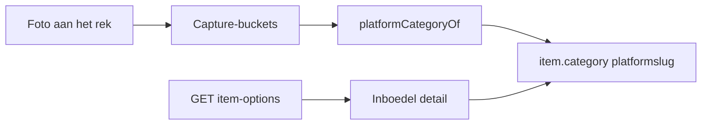

# Categorie-taxonomie (platform ↔ telefoon)

> Gecontroleerd op: `be46e93`+ (2026-11-22) — TAX-01/02 getest; TAX-03/04 tegen code  
> Bronnen: `submission/domain/category-map.ts`, `platform-categories.ts`, `capture/domain/interpret-labels.ts`, `capture/domain/category-labels.ts`, `inventory/api/shop-item-detail.ts`, `inventory/screens/inventory-item-screen.tsx`, ADR [0021](../decisions/0021-categorie-taxonomie.md), platform `docs/product/categorie-taxonomie.md`  
> Zie ook: [categorie-model](categorie-model.md) (TFLite), [inboedel](inboedel.md), [kleur-en-labels](kleur-en-labels.md)

## Waarvoor

Uitleggen **waar een type leeft**, wat de telefoon offline kent, en wat je doet als er een **nieuw type** bij komt (bijv. iemand fotografeert een duikpak).

## Twee lagen

| Laag               | Wat                                                                       | Bron                                                         |
| ------------------ | ------------------------------------------------------------------------- | ------------------------------------------------------------ |
| **Platformtype**   | Opgeslagen `item.category` (NL-slug: `trui`, `sneaker`, `zwemkleding`, …) | `@occa/core` → contracts `PLATFORM_CATEGORIES` → Expo-vendor |
| **Capture-bucket** | Grove keuze in scan-UI / home-secties (`top`, `broek`, `schoenen`, …)     | `PRODUCT_CATEGORIES` + i18n via `categoryMessageKey`         |

Omzetting bucket → platformslug gebeurt alleen bij versturen (`platformCategoryOf`). Labels op scherm: i18n (buckets) of API `?locale=` (Inboedel).

## Beweringen

| ID     | Bewering                                                                                                            | Code                                               | Test                      |
| ------ | ------------------------------------------------------------------------------------------------------------------- | -------------------------------------------------- | ------------------------- |
| TAX-01 | Outbound categorie bij submit is een canonieke platformslug (geen synoniem zoals `sneakers`).                       | `category-map.ts`, `platform-categories.ts`        | `category-map.test.ts`    |
| TAX-02 | Elke capture-bucket heeft een i18n-key `capture.category.<id>` zonder per-scherm maps.                              | `category-labels.ts`, `resources.ts`               | `category-labels.test.ts` |
| TAX-03 | Inboedel-categoriekeuze komt van `GET /item-options` (volle platformlijst + labels), niet van `PRODUCT_CATEGORIES`. | `shop-item-detail.ts`, `inventory-item-screen.tsx` | —                         |
| TAX-04 | Scan-formulier biedt alleen `PRODUCT_CATEGORIES` als categoriekeuze.                                                | `capture-screen.tsx`                               | —                         |

## Nieuw type: twee paden

### Pad A — synoniem / bestaand type (meestal genoeg)

Voorbeeld: duikpak hoort bij bestaand type `zwemkleding`.

1. Platform: `CATEGORY_SYNONYMS` (+ zoek-/EN-woorden indien nodig) in `@occa/core`.
2. **Geen** nieuwe Expo-bucket, **geen** `category-map`-wijziging, **geen** vendor-update.
3. Artikel aanmaken via scan blijft mogelijk; juiste type zetten in Inboedel (item-options) of op partner-web.

### Pad B — echt nieuw platformtype

1. `@occa/core` `CATEGORIES` (+ vocabulary EN, migratie/synoniemen).
2. `packages/contracts` `PLATFORM_CATEGORIES` tot set-gelijk (contracts-test).
3. Expo: kopieer allowlist naar `platform-categories.ts`.
4. **Optioneel — alleen als scan-UI het type moet tonen:**
   - `PRODUCT_CATEGORIES` + `capture.category.*` in `resources.ts` (nl én en)
   - `category-map.ts`: bucket → nieuwe slug
   - later: training / TFLite als het model het moet herkennen

Zonder stap 4: Inboedel toont het nieuwe type **zodra de API live is** (item-options / filters). Scan blijft grof tot je bewust een bucket toevoegt.

## Wat runtime synct vs app-release

| Onderdeel                                | Hoe “gelijk”                                                      |
| ---------------------------------------- | ----------------------------------------------------------------- |
| Inboedel filters, item-edit categorieën  | Runtime via shop-API — geen app-release voor nieuwe platformtypes |
| Capture-buckets + offline map            | App-release + ritueel core → contracts → vendor                   |
| On-device herkenning van het nieuwe type | Training / model-update (apart)                                   |

## Wijzigingsritueel (samenvatting)

Zie ADR [0021](../decisions/0021-categorie-taxonomie.md). Op het platform (Occa Next.js-repo): `docs/product/categorie-taxonomie.md`.

1. Owner: `@occa/core`.
2. Wire: contracts-allowlist.
3. Expo-vendor + eventueel map/buckets.
4. CI: allowlist ≡ core; mapping ⊆ allowlist.

## Open / bewust niet

- Capture toont niet alle ~59 platformtypes (bewuste snelheid aan het rek).
- Geen UUID’s voor types; opslag blijft NL-slug, EN is weergave/zoeklaag op het platform.
