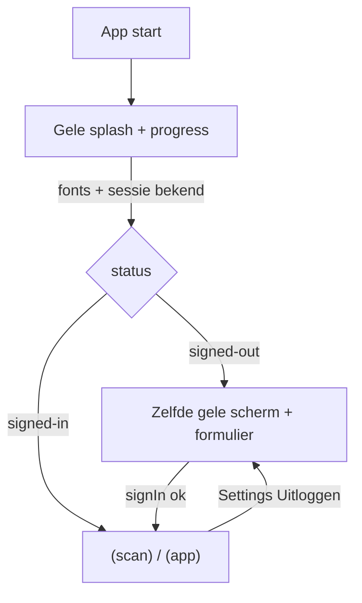

# Inloggen

> Gecontroleerd op: `be46e93` (2026-11-22)
> Bronnen: `src/app/_layout.tsx`, `src/domeinen/auth/`, `src/domeinen/settings/screens/settings-screen.tsx`
> Zie ook: [ADR 0008](../decisions/0008-sessies-en-tokens.md), [ADR 0017](../decisions/0017-inlogmethode-per-build.md), [shop-api.md](shop-api.md), [conventions.md](../conventions.md) §4

## Waarvoor

Alleen een ingelogde medewerker mag scannen of Inboedel zien. Zelfde accounts als partner wanneer
de build `supabase` gebruikt.

## Hoe het werkt

- `unknown` of fonts niet klaar → `SplashScreenView` (progress).
- `signed-out` → `LoginScreen` (geen stack met scan/app).
- `signed-in` → Stack `(scan)` + `(app)`.
- Methode per build (`EXPO_PUBLIC_AUTH_PROVIDER`): `supabase` = e-mail + wachtwoord; `demo` = één
  knop; `azure-ad` blijft mogelijk via authenticator maar is niet de product-UI van Remi.
- Formulierstatus (e-mail, wachtwoord, busy, foutmelding) via `login.action.ts` + `useLoginForm`.

## Beweringen

| ID      | Bewering                                                                                         | Code                        | Test                                             |
| ------- | ------------------------------------------------------------------------------------------------ | --------------------------- | ------------------------------------------------ |
| AUTH-01 | Bij `signed-out` toont de root alleen `LoginScreen`, niet de app-stack.                          | `src/app/_layout.tsx`       | —                                                |
| AUTH-02 | Bij `unknown` of fonts niet klaar blijft de gele splash zichtbaar.                               | `src/app/_layout.tsx`       | —                                                |
| AUTH-03 | Succesvol `signIn` zet tokens via de TokenProvider; tokens staan nergens anders in app-state.    | `auth-service.ts`, ADR 0008 | `auth-service.test.ts`, `token-provider.test.ts` |
| AUTH-04 | Bij `method === 'supabase'` vraagt het loginscherm e-mail en wachtwoord.                         | `login-screen.tsx`          | —                                                |
| AUTH-05 | Settings heeft een Uitloggen-actie die `authService.signOut()` aanroept.                         | `settings-screen.tsx`       | —                                                |
| AUTH-06 | Na uitloggen wist `clearUserData` o.a. querycache, scans en gekozen filiaal (taal blijft).       | `container.ts`              | `container.test.ts`                              |
| AUTH-07 | Een verlopen sessie (`signedOutReason === 'expired'`) toont de sessie-verlopen-melding op login. | `login-screen.tsx`          | —                                                |
| AUTH-08 | Login-fouten mappen naar i18n-sleutels; geannuleerd toont geen melding.                          | `login-failures.ts`         | `login-failures.test.ts`                         |
| AUTH-09 | Lokale login-UI-state zit in een pure reducer (`login.action.ts`), niet in losse `useState`s.    | `login.action.ts`           | `login.action.test.ts`                           |

## Randgevallen en bewuste keuzes

- Geen aparte Expo-route `/login`; het scherm hangt aan de gate in `_layout`.
- Na login kiest Inboedel automatisch het (eerste) filiaal; er is geen choose-store-stap.

## Open vragen

- Geen; shop-auth aangenomen in [open-vragen.md](../functioneel/open-vragen.md) rij 2.
