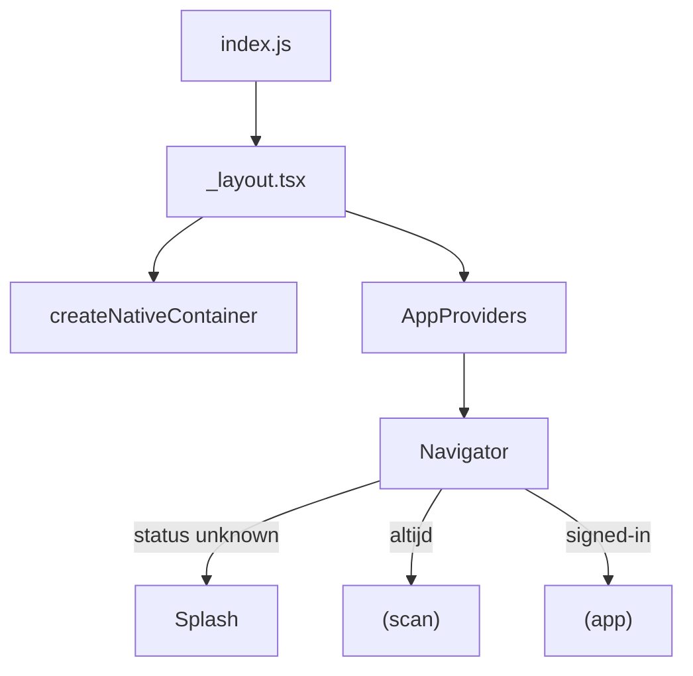

# Overzicht

> Gecontroleerd op: `aa8cfdc` (2026-10-10)
> Bronnen: `src/bootstrap/`, `src/app/_layout.tsx`, `src/app/(app)/_layout.tsx`, `docs/architecture.md`
> Zie ook: [architecture.md](../architecture.md), [occa-brief](../occa-brief.md)

## Waarvoor

Eén startpunt dat container, providers en navigatie verbindt. Zonder dit is onduidelijk wanneer de
medewerker mag scannen of naar home gaat.

## Hoe het werkt

`createNativeContainer()` bouwt één keer bij appstart. `container.start()` herstelt taal en sessie.
De scan-route `(scan)` is de `initialRouteName` en staat buiten de auth-guards: scannen kan direct.
`(app)` (home, item) hangt aan sessiestatus via `Stack.Protected`.

## Beweringen

| ID      | Bewering                                                                                     | Code                          | Test                   |
| ------- | -------------------------------------------------------------------------------------------- | ----------------------------- | ---------------------- |
| BOOT-01 | De container wordt één keer gebouwd bij laden van de root layout.                            | `src/app/_layout.tsx`         | —                      |
| BOOT-02 | Bij `status === 'unknown'` blijft de splash zichtbaar tot de sessie bekend is.               | `src/app/_layout.tsx`         | —                      |
| BOOT-03 | `(scan)` is de initiële route en staat niet achter een auth-guard.                           | `src/app/_layout.tsx`         | —                      |
| BOOT-04 | `(app)` is alleen bereikbaar bij `signed-in`.                                                | `src/app/_layout.tsx`         | —                      |
| BOOT-05 | Domein-dependencies komen via `AppProviders` uit de container (geen singletons in domeinen). | `src/bootstrap/providers.tsx` | `architecture.test.ts` |
| BOOT-06 | Productie-UI gebruikt het custom TFLite-categoriemodel via `CategoryModelProvider`.          | `src/bootstrap/providers.tsx` | —                      |

## Randgevallen en bewuste keuzes

- Scannen zonder sessie is bewust (POC-snelheid). Opslaan stuurt alleen naar `/home` als er een
  sessie is; anders blijft de camera open voor de volgende foto.

## Open vragen

- Geen open vraag specifiek voor bootstrap; zie [open-vragen.md](../functioneel/open-vragen.md).
