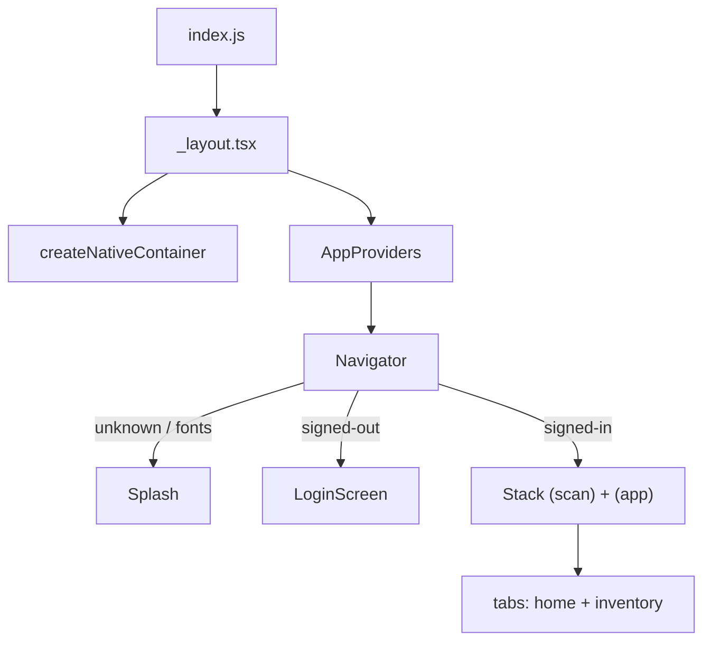

# Overzicht

> Gecontroleerd op: `be46e93` (2026-11-22)
> Bronnen: `src/bootstrap/`, `src/app/_layout.tsx`, `src/app/(app)/_layout.tsx`, `docs/architecture.md`
> Zie ook: [architecture.md](../architecture.md), [inloggen.md](inloggen.md), [occa-brief](../occa-brief.md)

## Waarvoor

Eén startpunt dat container, providers, login-gate en navigatie verbindt. Zonder dit is onduidelijk
wanneer de medewerker mag scannen of Inboedel ziet.

## Hoe het werkt

`createNativeContainer()` bouwt één keer bij appstart. `container.start()` herstelt taal, sessie en
eventueel gekozen filiaal. De root `Navigator` poort op sessiestatus: splash → login of app-stack.
Binnen de app is `(app)` (tabs Home + Inboedel) de `initialRouteName`; scannen blijft via `(scan)`.

## Beweringen

| ID      | Bewering                                                                                     | Code                          | Test                   |
| ------- | -------------------------------------------------------------------------------------------- | ----------------------------- | ---------------------- |
| BOOT-01 | De container wordt één keer gebouwd bij laden van de root layout.                            | `src/app/_layout.tsx`         | —                      |
| BOOT-02 | Bij `status === 'unknown'` of fonts niet klaar blijft de splash zichtbaar.                   | `src/app/_layout.tsx`         | —                      |
| BOOT-03 | `(app)` (Home) is de initiële route **nadat** de gebruiker is ingelogd.                      | `src/app/_layout.tsx`         | —                      |
| BOOT-04 | Bij `signed-out` is de app-stack niet bereikbaar; alleen `LoginScreen`.                      | `src/app/_layout.tsx`         | —                      |
| BOOT-05 | Domein-dependencies komen via `AppProviders` uit de container (geen singletons in domeinen). | `src/bootstrap/providers.tsx` | `architecture.test.ts` |
| BOOT-06 | Productie-UI gebruikt het custom TFLite-categoriemodel via `CategoryModelProvider`.          | `src/bootstrap/providers.tsx` | —                      |
| BOOT-07 | `(app)`-tabs bevatten Home en Inboedel.                                                      | `(app)/(tabs)/_layout.tsx`    | —                      |

## Randgevallen en bewuste keuzes

- ~~BOOT-04 was eerder "geen auth-guard"~~ (2026-11-22): login-gate is productgedrag; zie
  [inloggen.md](inloggen.md).

## Open vragen

- Geen open vraag specifiek voor bootstrap; zie [open-vragen.md](../functioneel/open-vragen.md).
