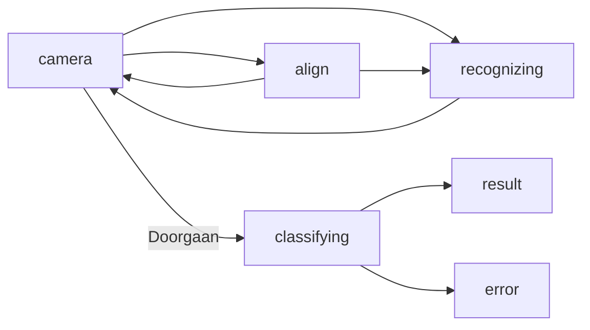

# Scannen

> Gecontroleerd op: `be46e93` (2026-11-22)
> Bronnen: `src/domeinen/capture/screens/capture-screen.tsx`, `domain/capture.action.ts`, `domain/frame-crop.ts`, `domain/scan-photos.ts`, `domain/merge-interpret-results.ts`, `platform/rn/crop-image.ts`, `platform/rn/mlkit-text-recognizer.ts`
> Zie ook: [categorie-model.md](categorie-model.md), [kleur-en-labels.md](kleur-en-labels.md), [conventions.md](../conventions.md) §4

## Waarvoor

Medewerker maakt of kiest foto’s van één item (overzicht en/of label) en krijgt een bewerkbaar
voorstel vóór opslaan.

## Hoe het werkt

Lokale UI-fasen (pure reducer `capture.action.ts`): `camera` → (`align` bij gallery) →
`recognizing` (labelfoto + ML Kit-tekst) of terug naar camera (overview) → na **Doorgaan**
`classifying` → `result` of `error`. Camera gebruikt een zichtbaar kader; gallery: pinch/pan dan
crop. Modus kleding vs label via segmented control. Op het resultaat: thumbnails, categorie, kleur,
subtype, patroon; Opslaan / Opnieuw. Overview-foto’s door TFLite + merge; labelfoto’s krijgen
on-device tekstherkenning in de draft.

## Beweringen

| ID      | Bewering                                                                                     | Code                                                   | Test                                                     |
| ------- | -------------------------------------------------------------------------------------------- | ------------------------------------------------------ | -------------------------------------------------------- |
| SCAN-01 | Camerafoto wordt bijgesneden tot het kader vóór verder verwerken.                            | `capture-screen.tsx`, `frame-crop.ts`, `crop-image.ts` | `frame-crop.test.ts`                                     |
| SCAN-02 | Galleryfoto gaat via align (pinch/pan) en crop vóór verder verwerken.                        | `align-photo.tsx`, `capture-screen.tsx`                | —                                                        |
| SCAN-03 | Tijdens classify toont de UI een classificatiefase (geen stille blokkade zonder feedback).   | `capture-screen.tsx`, `capture.action.ts`              | `capture.action.test.ts`                                 |
| SCAN-04 | Opslaan schrijft pas dan naar de scan-store met listing uit het formulier.                   | `capture-screen.tsx`, `draft-from-labels.ts`           | `draft-from-labels.test.ts`, `scan-store.test.ts`        |
| SCAN-05 | Opnieuw wist foto’s + formulier en keert terug naar de camera.                               | `capture-screen.tsx`, `capture.action.ts`              | `capture.action.test.ts`                                 |
| SCAN-06 | Zichtbare teksten komen uit i18n (`capture.*`), niet hardcoded in het scherm.                | `capture-screen.tsx`, `resources.ts`                   | —                                                        |
| SCAN-07 | Max. overview-foto’s + optioneel label; alleen overview door het model; merge-resultaat.     | `scan-photos.ts`, `merge-interpret-results.ts`, UI     | `scan-photos.test.ts`, `merge-interpret-results.test.ts` |
| SCAN-08 | Subtype alleen van labels die bij de gekozen categorie horen (geen Hat→hoed op een top).     | `interpret-labels.ts`                                  | `interpret-labels.test.ts`                               |
| SCAN-09 | Capture gebruikt `choose` voor categorie/kleur/subtype/patroon.                              | `capture-screen.tsx`                                   | —                                                        |
| SCAN-10 | Fase, flash, modus en resultformulier zitten in `capture.action.ts` (geen losse `useState`). | `capture.action.ts`, `use-capture-ui.ts`               | `capture.action.test.ts`                                 |
| SCAN-11 | Een labelfoto triggert on-device tekstherkenning; de tekst komt in de draft.                 | `mlkit-text-recognizer.ts`, `capture-screen.tsx`       | —                                                        |
| SCAN-12 | Na crop past de app fit-inside ≤1540 px / JPEG 0,82 toe (web-resolutie, zie foto-grootte).   | `crop-image.ts`, `upload-photo-size.ts`                | `upload-photo-size.test.ts`                              |

## Randgevallen en bewuste keuzes

- Zonder cameramachtiging: permission-flow via `expo-camera`.
- Classify-/crop-/recognize-fout → errorfase met i18n-sleutel, geen crash naar home.
- Label-OCR vult draft-tekst; cloud/OCR-pipeline uit de brief is nog niet de hele flow.
- Foto's zijn voor online gebruik; zie [foto-grootte.md](foto-grootte.md).

## Open vragen

- Geen.
